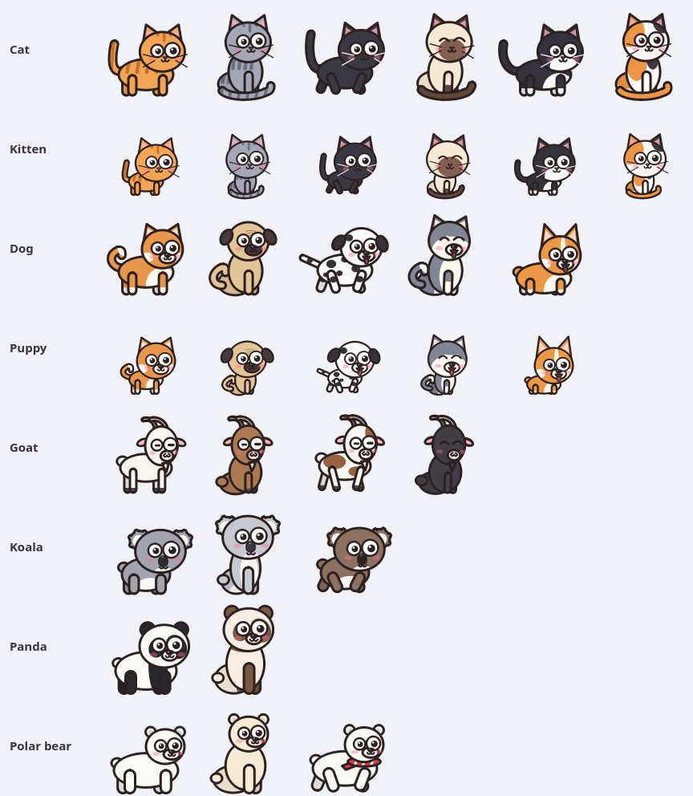
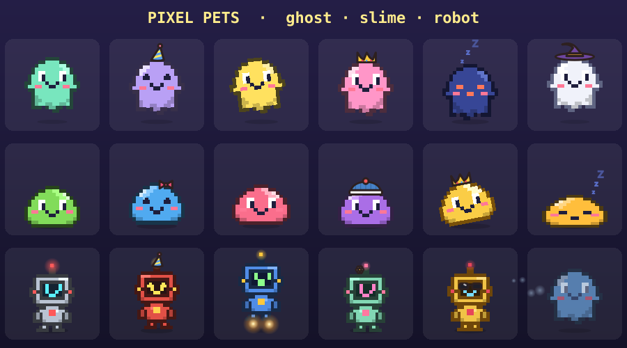
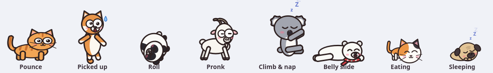
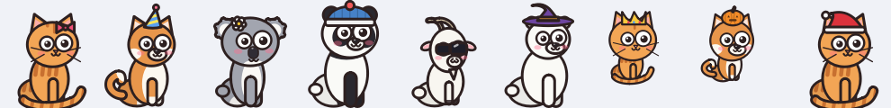
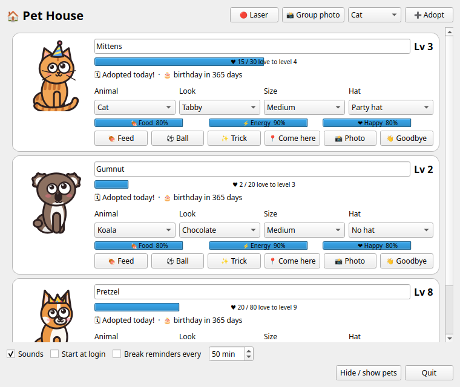
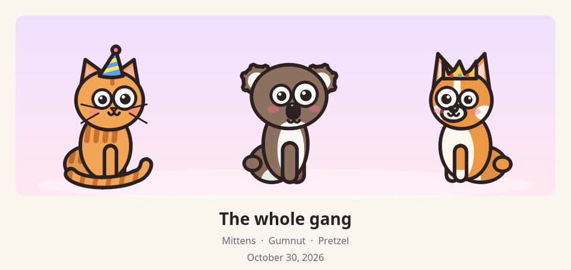

# 🐾 Desktop Pets

Funny little cartoon pets that live on top of your desktop. They walk around, nap,
do tricks, chase your mouse, beg for food, and get excited when you come back to
your computer. Works on **Linux** and **Windows**.



## Features

- **11 kinds of pet, 52 looks:** cat and kitten (tabby, gray, black, siamese, tuxedo, calico),
  dog and puppy (shiba, pug, dalmatian, husky, corgi), panda, polar bear, koala and goat.
  Everything is drawn in code, with googly eyes that follow your mouse.
- **👾 Retro pixel pets:** three 8-bit arcade-style friends, each with its own tricks.
  - **Pixel Ghost:** floats instead of walking. It turns see-through and glides across the
    screen, drifts up to haunt it, and sneaks up on the other pets to shout *BOO!*
  - **Pixel Slime:** a wobbly jelly blob that hops around and squishes when it lands.
  - **Pixel Robot:** a little bot with a screen for a face and rocket boots for blasting off.

  
- **👾 Dot Dash arcade game:** a trail of glowing dots appears along the bottom of your
  screen and every pet races to gobble them. Power dots give a burst of speed, and bonus
  stars drop in now and then. When the 60-second clock runs out, the top scorer wins.
- **🌦 Weather:** snow, rain, autumn leaves, cherry blossoms or fireflies drift over your
  desktop. *Auto* picks the weather from the season. Clicks pass straight through.
- **🏆 Achievements:** 20 goals to unlock, from "Hello, friend" to "High score" and "Liftoff".
  Find them in the right-click menu.
- **😢 Moods you can see:** a hungry pet sits up and begs with big pleading eyes. Its tummy
  rumbles and a thought bubble shows the food it's dreaming of. An unhappy pet turns its back,
  slumps and sighs under its own little rain cloud. Petting or feeding chases the gloom away.
  Hungry or sad pets also walk more slowly.
- **🕺 Dance parties:** any pet can dance (floating music notes included). Pick a specific
  trick from the new *Tricks* menu.
- **Always on top:** pets walk along the bottom of your screen above every window.
- **Play with them:** click to pet, rub your mouse over them to stroke, drag to carry,
  fling to throw, double-click to make them jump.
- **Care:** food, energy and happiness go down over time. Feed them (each animal has a
  favourite food), let them nap, and give them attention. Their faces show when they're
  hungry, tired or sad. Nothing ever dies.
- **Tricks:** zoomies, pouncing at your cursor, chasing their tail, rolling (panda),
  pronking and head-butting the screen (goat), belly sliding (polar bear), and climbing
  the screen edge to nap (koala).

  
- **Toys:** a bouncy ball they chase and kick, and a 🔴 laser pointer that drives them wild.
- **Friends:** keep up to 10 pets. They greet each other and play chase.
- **Friendship levels:** caring earns love. Levelling up sets off confetti and unlocks hats.
  There are also seasonal hats (a pumpkin around Halloween and a Santa hat in December).

  
- **Pet House:** a control panel for every pet, with live previews, stats, names, looks,
  hats and settings. Click the tray icon to open it.

  
- **Life events:** pets nap when you're away from the computer and welcome you back.
  They celebrate birthdays and friendship milestones.
- **Photos:** save a polaroid of one pet, or a group photo, to `Pictures/Desktop Pets`.

  
- **Extras:**
  - Optional break reminders: "stand up and stretch!", "drink some water 💧".
  - Cartoon sounds, which you can mute.
  - Sleepy pets at night.
  - Start at login.
  - Everything is saved between runs.

---

## Install on Linux

You need **Python 3.10 or newer**. Ubuntu 22.04 and later already include it.

### 1. Install the system libraries Qt needs

```bash
# Ubuntu / Debian / Mint / Pop!_OS
sudo apt install python3-venv libxcb-cursor0 libxkbcommon-x11-0 libxcb-icccm4 libxcb-keysyms1 libxcb-xkb1

# Fedora
sudo dnf install python3 xcb-util-cursor xcb-util-wm xcb-util-keysyms libxkbcommon-x11

# Arch / Manjaro
sudo pacman -S python xcb-util-cursor xcb-util-wm xcb-util-keysyms libxkbcommon-x11
```

### 2. Get the code and run the installer

```bash
git clone https://github.com/AhmadReza2003H404/Desktop-Pet.git
cd Desktop-Pet
./install.sh
```

The installer does four things:
1. Creates a private Python environment in `.venv`.
2. Installs PySide6.
3. Adds **Desktop Pets** to your app menu.
4. Starts your first pet.

From then on, launch it from the app menu like any other app.

<details>
<summary>Manual install (without the script)</summary>

```bash
python3 -m venv .venv
.venv/bin/pip install -r requirements.txt
.venv/bin/python main.py --install   # optional: add to the app menu
.venv/bin/python main.py             # run it
```
</details>

**Linux notes**
- On **Wayland** (the GNOME default), the app runs through XWayland automatically. That's
  what allows it to stay on top and place pets anywhere. You don't need to set anything up.
- The **tray icon** on GNOME needs the *AppIndicator* extension. Ubuntu has it enabled by
  default. On other distros, install "AppIndicator and KStatusNotifierItem Support".
- **Away mode** (napping while you're away) reads your idle time from GNOME. On other desktops,
  that one feature simply stays off.

---

## Install on Windows

### 1. Install Python

Download **Python 3.10 or newer** from [python.org](https://www.python.org/downloads/windows/).
In the installer, **tick "Add python.exe to PATH"**.

You can also install it from a terminal:

```powershell
winget install Python.Python.3.12
```

### 2. Get the code

Do one of these:
- Click **Code → Download ZIP** on GitHub and unzip it, for example into `Documents\Desktop-Pet`.
- Clone it with git:
  ```powershell
  git clone https://github.com/AhmadReza2003H404/Desktop-Pet.git
  ```

### 3. Run the installer

Double-click **`install.bat`** in the folder. If Windows SmartScreen warns about it, click
**More info → Run anyway**. The installer does four things:
1. Creates a private Python environment in `.venv`.
2. Installs PySide6.
3. Adds **Desktop Pets** to the Start Menu.
4. Starts your first pet.

From then on, open **Desktop Pets** from the Start Menu.

<details>
<summary>Manual install (without the script)</summary>

```powershell
py -3 -m venv .venv
.venv\Scripts\python -m pip install -r requirements.txt
.venv\Scripts\python main.py --install      # optional: add to the Start Menu
.venv\Scripts\pythonw main.py               # run it (pythonw = no console window)
```
</details>

**Windows notes**
- The pets walk on top of the taskbar. The tray icon may hide in the **^** overflow
  area; drag it onto the taskbar to keep it visible.
- **Start at login** (in Pet House or the menu) adds an entry to *Settings → Apps → Startup*.

---

## How to play

| Do this | What happens |
|---|---|
| Click a pet | Pet it: hearts, purring, and +love |
| Rub the mouse over it | Stroke it (sleeping pets stay asleep) |
| Drag it | Carry it around. Let go mid-drag to throw it |
| Double-click it | It jumps |
| Right-click it | The pet menu: feed, play ball, tricks, dance, sit, sleep in a corner, follow your mouse, hats, rename, change animal, size, photos, Dot Dash, weather, achievements… |
| Click the tray icon | Opens **Pet House** |
| Double-click the ball | Puts the ball away |

From the command line:

```bash
python main.py                 # your saved pets
python main.py kitten calico   # start with a particular animal
python main.py --list          # every animal and look
python main.py --install       # add to the app menu / Start Menu
```

## Where your data lives

| | Linux | Windows |
|---|---|---|
| Pets and settings | `~/.config/desktop-pets/state.json` | `%APPDATA%\DesktopPets\state.json` |
| Generated sounds | `~/.cache/desktop-pets/` | `%LOCALAPPDATA%\DesktopPets\` |
| Photos | `~/Pictures/Desktop Pets/` | `Pictures\Desktop Pets\` |
| App menu entry | `~/.local/share/applications/desktop-pets.desktop` | Start Menu → *Desktop Pets* |

## Uninstall

1. Quit the app: tray icon → **Quit**.
2. Turn off **Start at login** if you enabled it.
3. Delete the project folder, and the data folders above if you want a clean slate.

## Add your own animal

Every animal is one file in `species/`. Subclass `Quadruped` (in `render/quadruped.py`):
it already does every pose and trick. Then describe the look:

```python
from PySide6.QtGui import QColor
from core.pet import State
from render.quadruped import Quadruped


class Fox(Quadruped):
    species = "fox"
    name = "Fox"
    palettes = {"red": {"base": QColor(230, 110, 50)}, "arctic": {"base": QColor(245, 245, 250)}}
    variants = list(palettes)
    nose_kind = "dog"
    muzzle = (0.15, 0.33, 0.38, 0.26)
    specials = ["pounce", "zoomies"]
    favorite_food = "fish"

    def behind_head(self, p, c, r, v):
        self.pointy_ears(p, c, r, height=1.5)
```

Save it as `species/fox.py`. The fox then shows up in every menu, in Pet House, and in `--list`
without any other changes. Look at `species/panda.py` for a short complete example.

### Or a pixel-art one

Subclass `PixelPet` (in `render/pixel.py`) and draw the sprite as text. Each character
is a colour from the palette (`O` outline, `B` base, `L` light, `S` shade, `P` blush), and
`.` is see-through. Eyes and mouth are drawn on top, so they still follow your mouse:

```python
from PySide6.QtGui import QColor
from render.pixel import EyeBox, PixelPet, palette


class Blob(PixelPet):
    species = "blob"
    name = "Blob"
    palettes = {"teal": palette(QColor(80, 200, 190))}
    variants = ["teal"]
    eyes = [EyeBox(2, 2), EyeBox(6, 2)]
    mouth_at = (3, 5)
    specials = ["pronk", "dance"]

    def frame(self, view):
        return ["..OOOOOO..",
                ".OBBBBBBO.",
                "OBBBBBBBBO",
                "OBBBBBBBBO",
                "OBPBBBBPBO",
                "OBBBBBBBBO",
                ".OOOOOOOO."]
```

See `species/slime.py`, `species/ghost.py` and `species/robot.py` for complete examples.

## Project layout

```
main.py            entry point
core/              behaviour: pet interface, brain, physics, needs, tricks, levels, achievements, saving
render/            drawing: shared skeleton (quadruped.py), pixel-art pets (pixel.py), faces, hats, food
species/           one file per animal
ui/                windows: pet window, Pet House, menus, tray, ball, laser, Dot Dash, weather, photos, sounds
```

Made with Python and [PySide6](https://doc.qt.io/qtforpython-6/) (Qt).
